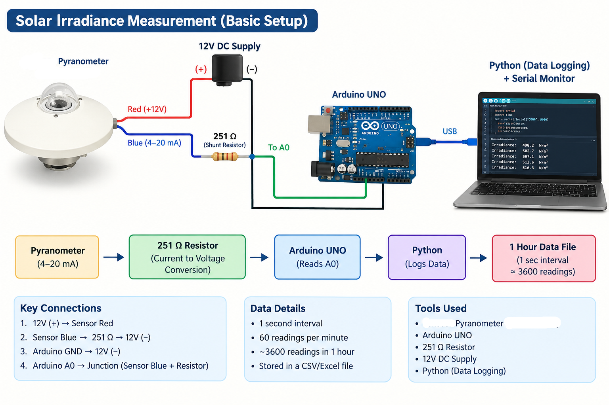
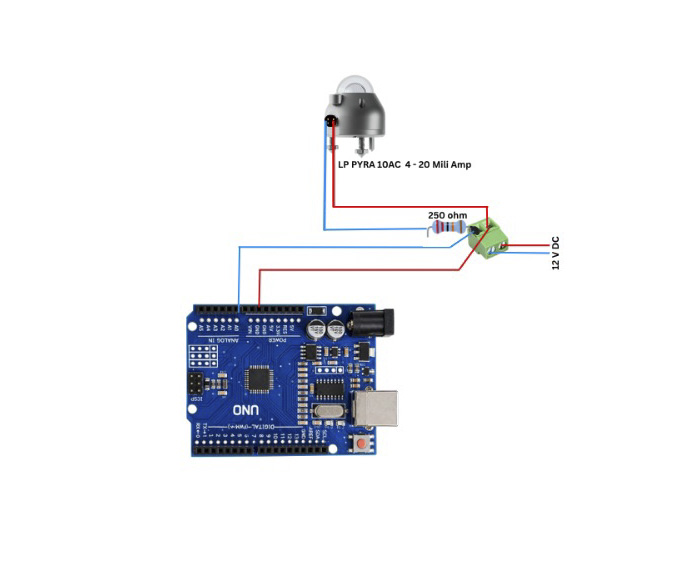
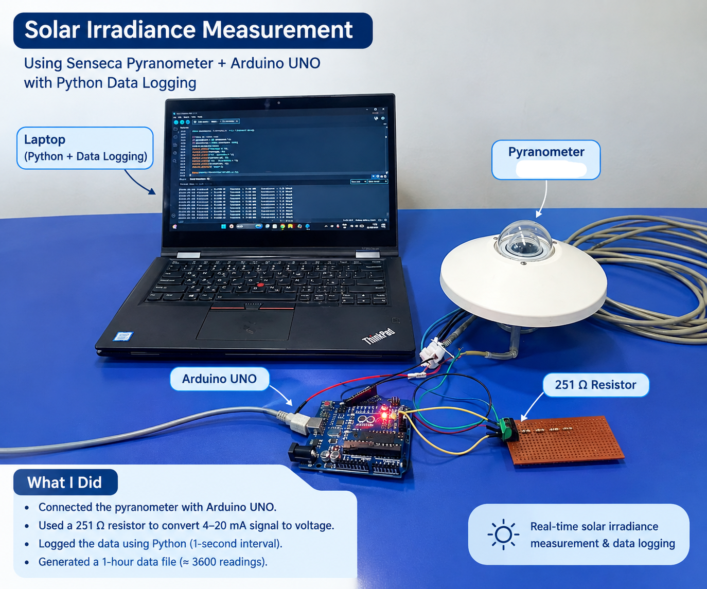
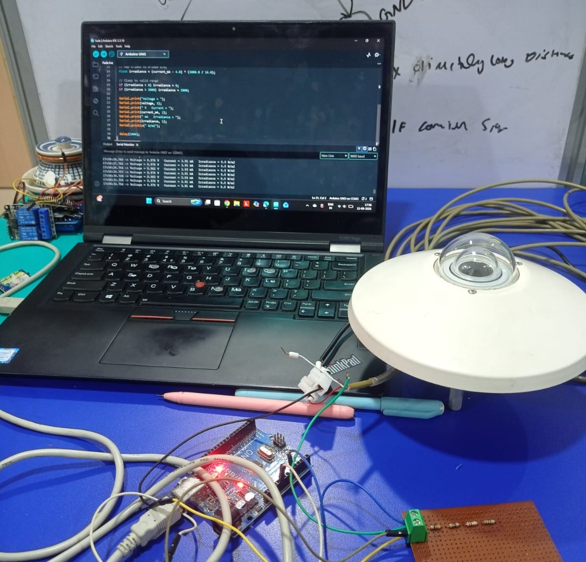
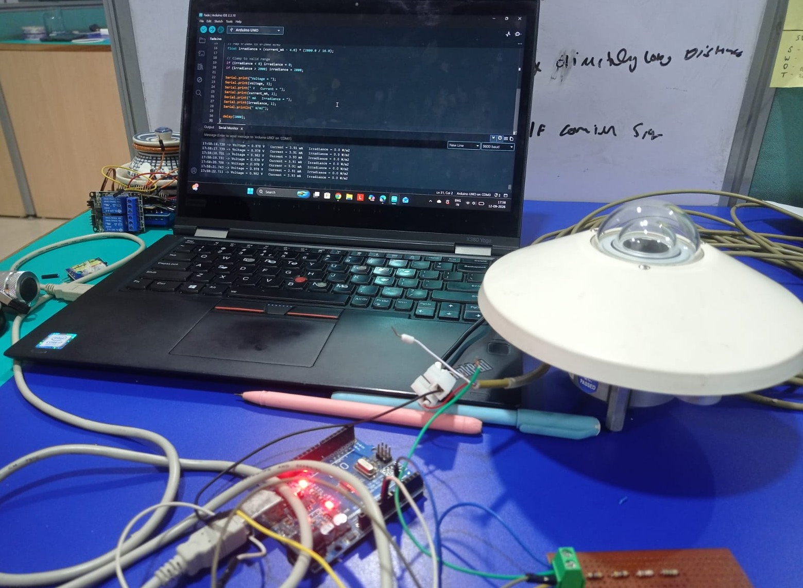
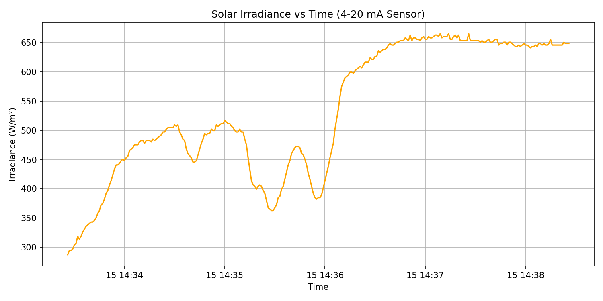

# solar-4-20mA-data-logger
Arduino and Python data logger with live Flask dashboard for a 4-20 mA solar radiation sensor
# 4-20 mA Solar Radiation Sensor Data Logger

## Overview
This project reads a 4-20 mA solar radiation sensor using an Arduino Uno,
logs the data to CSV files using Python, and shows live readings on a
Flask web dashboard.

## Hardware
- Arduino Uno
- 4-20 mA solar radiation sensor
- 250 ohm resistor

## How it works
1. The sensor outputs a 4-20 mA current signal.
2. A 250 ohm resistor converts this current to 1-5 V.
3. The Arduino reads the voltage with its ADC and sends the values over serial in CSV format.
4. A Python script (pyserial) reads the serial data and saves it to rotating CSV files.
5. A Flask dashboard shows the live data in a web browser.
6. Matplotlib is used to plot graphs from the saved CSV files.

## Wiring diagram

## Hardware setup

## Sample data
`sample_data.csv` has these columns: Timestamp, Elapsed (s), Voltage (V), Current (mA), Irradiance (W/m2).

## Sample graph

## Files
- `solar_4_20mA_logger.ino`: Arduino code
- `sample_data.csv`: sample logged data
- `project_documentation.pdf`: full documentation with setup steps, Python logging code and Flask dashboard code
